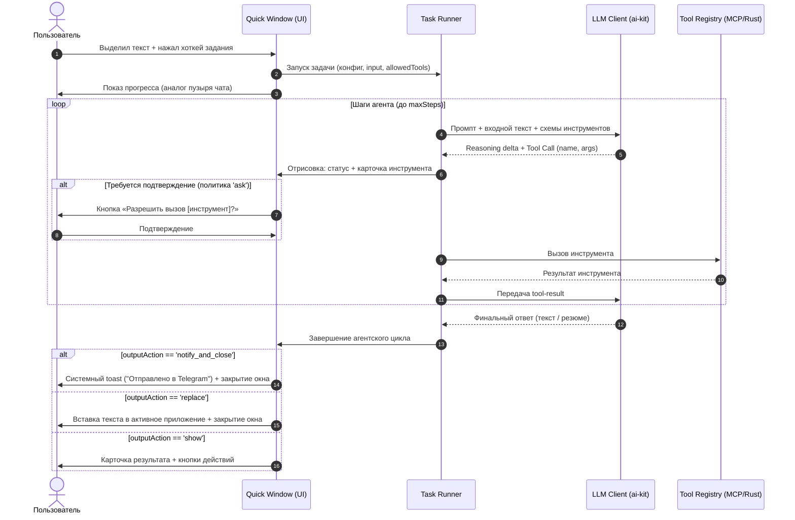

# Дизайн: Функциональные задания для ИИ (AI Tasks & Actions)

Статус: проектирование  
Дата: 2026-10-29  
Стек: Vue 3, Pinia, TypeScript, Rust (Tauri 2), `@bozonx/ai-kit` (Vercel AI SDK 7)

---

## 1. Концепция и цели

Исторически «Задания для ИИ» в TyCo были простым текстовым преобразованием (`Text -> LLM -> Text`), выполняя рерайтинг, форматирование или сжатие. Позже эти сценарии были выделены в специализированные функции («Стили» и «Трансформации текста»).

Цель этого дизайна — превратить **Задания для ИИ (AI Tasks)** в полноценные **агентные действия** над выделенным текстом или пользовательским вводом с возможностью:
- Использовать подключённые **MCP-серверы** (Telegram, GitHub, Linear, Notion, SQLite, Google Calendar и др.);
- Вызывать существующие пользовательские **команды TyCo** (скрипты, вебхуки);
- Автономно извлекать параметры из неструктурированного текста и выполнять цепочки действий;
- Завершать процесс выбранным способом (замена текста, показ результата или фоновое уведомление);
- При необходимости бесшовно передавать контекст выполнения в полноценный чат для продолжения работы.

---

## 2. Разграничение: Задания, Команды и Трансформации

В архитектуре TyCo закрепляется трёхчастное деление:

| Сущность | Природа | Сайд-эффекты | Входные требования | Завершение |
| :--- | :--- | :--- | :--- | :--- |
| **Трансформации и стили** | Чистая функция `f(text) -> text` | Нет (строго запрещены) | Текст любого качества | Замена выделенного текста / предпросмотр |
| **Команды (Commands)** | Детерминированный скрипт / webhook | Фиксированные (код скрипта) | Чёткие параметры или `llmPreTransform` | По действию команды (`replace`, `copy`, `none`) |
| **Задания ИИ (AI Tasks)** | Одноходовый агент (LLM + Tool Calling) | Динамические (вызовы инструментов) | Свободный текст, из которого агент извлекает суть | Настраиваемое действие (`replace`, `show`, `notify_and_close`) |

### Почему Задания ИИ не дублируют Команды?
1. **Команды — это строительные блоки (Tools).** Команда требует точных параметров и исполняет неизменный алгоритм.
2. **Задания ИИ — это интеллектуальный оркестратор.** Они понимают естественный язык («занеси встречу на следующий вторник в 15:00») и сами формируют вызовы к MCP-серверам или тем же Командам. Пользователю не нужно писать код и настраивать парсинг JSON.

---

## 3. Модель конфигурации задания (`AiTaskConfig`)

Конфигурация расширяет существующую структуру `AiTaskConfig` в `packages/shared/src/user-config.ts`:

```typescript
export type AiTaskOutputAction = 
  | 'replace'          // Автоматически заменить выделенный текст на результат
  | 'insert'           // Вставить результат на позицию курсора
  | 'show'             // Показать карточку результата в окне с действиями
  | 'notify_and_close' // Закрыть окно сразу, показать toast (для сайд-эффектов)

export interface AiTaskConfig {
  id: string
  name: string
  icon?: string
  
  /** Инструкция агенту: что сделать с входным текстом */
  prompt: string
  
  /** Модель для выполнения (пусто = использовать модель по умолчанию для AI Tasks) */
  modelId?: string
  
  /**
   * Список разрешённых инструментов для этого задания.
   * Ограничение скоупа ускоряет ответ, экономит токены и защищает от галлюцинаций.
   * Формат: 'mcp:<server>:<tool>' | 'command:<id>' | 'core:<tool>'
   */
  allowedTools: string[]
  
  /** Действие по умолчанию после завершения работы агента */
  outputAction: AiTaskOutputAction
  
  /** Максимальное количество шагов агента (защита от зацикливания, default: 5) */
  maxSteps?: number
}
```

Настройки редактируются в карточке задачи: пользователь пишет инструкцию, отмечает чекбоксами доступные инструменты и выбирает дефолтное действие при успехе.

---

## 4. Жизненный цикл выполнения и UX

Вызов задания происходит поверх любого приложения через Quick Window (меню действий / хоткей):



### Визуализация выполнения (Execution Overlay)
Окно выполнения стилизуется единообразно с карточками ответов в чате:
- **Шапка:** Название и иконка задачи + кнопка отмены (`Esc`).
- **Стриминг мыслей (Reasoning):** Краткий статус (например, *«Анализирую текст...»*).
- **Шаги инструментов:** Компактные плашки с названием инструмента, ключевыми аргументами и статусом (`loading` → `done` / `error`).
- **Финальный блок:** Текст ответа или подтверждение выполнения.

После возврата финального ответа агент **полностью останавливает работу** — фоновых процессов нет.

---

## 5. Стратегия истории: Общая vs Отдельная

### Анализ вариантов
1. **Только в Editor History (общая текстовая история):**
   * *Плюс:* Единое место, где пользователь ищет всё, с чем работал.
   * *Минус:* Теряются метаданные: какие инструменты вызывались, с какими аргументами и какой статус вернули.
2. **Изолированная отдельная история задач:**
   * *Плюс:* Полная структура шагов.
   * *Минус:* Фрагментация UX. Пользователю приходится переключаться между вкладками «История текста», «История чата», «История задач».

### Принятое решение: Гибридная модель
1. **Запись в общую историю (`EditorHistoryItem`):**
   Каждый запуск сохраняется в общую историю с типом операции `operation: 'aiTask'`:
   - `text`: исходный выделенный текст.
   - `result`: финальный текстовый ответ агента.
   - `meta`: имя задачи, иконка, статус (успех/ошибка).
   - `taskRunRef`: ссылка на детальный лог шагов.
2. **Детальный лог запуска (Task Run Details):**
   Внутренне сессия выполнения задачи представляет собой валидный массив `ChatMessage[]`:
   - `User`: Промпт задачи + входной текст.
   - `Assistant`: Сообщения с `toolCalls`.
   - `Tool`: Результаты выполнения инструментов.
   - `Assistant`: Финальное резюме.
   
   Этот лог сохраняется в локальной БД сессий выполнения. При клике на запись в общей истории пользователь может развернуть спойлер и увидеть точные вызовы инструментов.

---

## 6. Переход в чат («Открыть / продолжить в чате»)

Поскольку задание в 90% случаев — это быстрый разовый запрос, открывать полноценный чат сразу избыточно. Однако часто пользователю требуется развить результат.

### Механика кнопки «Продолжить в чате» (`Open in Chat`):
1. **Где отображается кнопка:**
   - В окне предпросмотра результата (`show`).
   - В карточке записи в истории.
2. **Что происходит при нажатии:**
   - Из лога выполнения формируется новая сессия чата (`ChatSession`).
   - Сессия привязывается к профилю по умолчанию (или профилю, ассоциированному с задачей).
   - Открывается главное окно TyCo на вкладке «Чат» с уже загруженными сообщениями и результатами работы инструментов.
   - Пользователь вводит следующее сообщение в том же контексте:
     * *«А теперь переведи отправленный текст на немецкий»*;
     * *«Покажи подробнее, что ответила база данных»*.

---

## 7. Действия с результатом в UI

Если задание настроено на режим `show` (предпросмотр) или если произошла ошибка, окно остаётся открытым и предлагает панель быстрых действий:

* **Вставить в редактор (`Enter` / Primary Action):**
  Вставляет финальный текст в активное приложение на место выделения (через `SelectionBackend` / `copy_and_paste`).
* **Скопировать в буфер (`Cmd/Ctrl+C`):**
  Копирует результат без изменения текста в исходном приложении.
* **Продолжить в чате (`Cmd/Ctrl+Shift+C`):**
  Конвертирует сессию в чат и открывает главное окно.
* **Повторить (`Cmd/Ctrl+R`):**
  Перезапускает выполнение задачи с теми же входными данными.
* **Закрыть (`Esc`):**
  Закрывает оверлей без применения изменений.

---

## 8. Безопасность и офлайн-ограничения

В соответствии с правилами `dev_docs/architecture.md` и `plan-chat-tools.md`:
1. **Политики вызовов (`allow` / `ask` / `deny`):**
   - Инструменты с побочными эффектами (отправка сообщений, запись в БД, запись файлов, запуск bash-скриптов) подчиняются общей политике безопасности.
   - В режиме `ask` оверлей приостанавливает выполнение и запрашивает явное согласие пользователя перед вызовом.
2. **Секреты:**
   - Токены MCP и авторизационные заголовки вебхуков хранятся исключительно в Rust `services/secrets` и не попадают в открытом виде в webview.
3. **Офлайн и CSP:**
   - Инструменты исполняются через Rust-бэкенд или локальные WASM/Worker рантаймы.
   - Никаких внешних скриптов или CDN. Сетевые вызовы идут строго через `services/net`.
