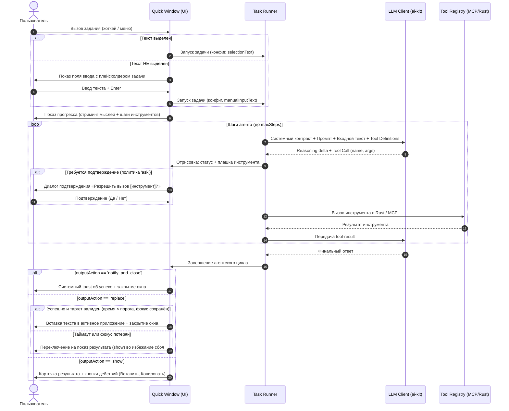

# Дизайн: Функциональные задания для ИИ (AI Tasks & Actions)

Статус: проектирование  
Дата: 2026-10-29  
Стек: Vue 3, Pinia, TypeScript, Rust (Tauri 2), `@bozonx/ai-kit` (Vercel AI SDK 7)

---

## 1. Концепция и цели

В предыдущих версиях TyCo «Задания для ИИ» были простым текстовым преобразованием (`Text -> LLM -> Text`). Позже чистая работа с текстом была вынесена в специализированные функции («Стили» и «Трансформации текста»).

Цель этого дизайна — превратить **Задания для ИИ (AI Tasks)** в полноценные **агентные действия** над выделенным текстом или пользовательским вводом:
- Использование подключённых **MCP-серверов** (Telegram, GitHub, Linear, Notion, SQLite, Google Calendar и др.);
- Вызов инструментов ядра и пользовательских команд TyCo;
- Автономное извлечение параметров из свободного текста и выполнение цепочек действий (tool calling);
- Гибкое завершение: замена текста, интерактивный просмотр результата или фоновое действие;
- Гарантия безопасности: никаких фоновых зависших процессов, строгие политики подтверждений, защита от потери фокуса приложения.

> [!NOTE]
> Дизайн разрабатывается начисто, без поддержки legacy-полей (`rule`) и без обратной совместимости со старыми форматами конфигурации.

---

## 2. Разграничение: Задания, Команды и Трансформации

В архитектуре TyCo закрепляется строгое трёхчастное деление:

| Сущность | Природа | Сайд-эффекты | Входные требования | Завершение |
| :--- | :--- | :--- | :--- | :--- |
| **Трансформации и стили** | Чистая функция `f(text) -> text` | Нет (строго запрещены) | Текст любого качества | Замена выделенного текста / предпросмотр |
| **Команды (Commands)** | Детерминированный скрипт / webhook | Фиксированные (код скрипта) | Чёткие параметры или `llmPreTransform` | По действию команды (`replace`, `copy`, `none`) |
| **Задания ИИ (AI Tasks)** | Одноходовый агент (LLM + Tool Calling) | Динамические (вызовы инструментов) | Свободный текст или ручной ввод | Настраиваемое действие (`replace`, `show`, `notify_and_close`) |

### Почему Задания ИИ не дублируют Команды?
1. **Команды — это детерминированные инструменты (Tools).** Команда требует точных параметров и исполняет неизменный алгоритм без рассуждений.
2. **Задания ИИ — это интеллектуальный оркестратор.** Они понимают естественный язык («занеси встречу на следующий вторник в 15:00») и сами формируют аргументы вызовов к MCP-серверам или Командам.

---

## 3. Модель конфигурации (`AiTaskConfig`)

Конфигурация создаётся начисто в `packages/shared/src/user-config.ts`:

```typescript
export type AiTaskOutputAction = 
  | 'replace'          // Заменить выделенный текст на результат
  | 'insert'           // Вставить результат на позицию курсора
  | 'show'             // Показать карточку результата в окне с действиями
  | 'notify_and_close' // Закрыть окно, показать toast (для сайд-эффектов)

export interface AiTaskConfig {
  id: string
  name: string
  icon?: string
  
  /** Инструкция агенту: цель задания и правила обработки */
  prompt: string
  
  /** Модель для выполнения (undefined = использовать общую модель для AI Tasks из userConfig.llm.tasks.aiTask) */
  modelId?: string
  
  /**
   * Список разрешённых инструментов для этого задания.
   * Ограничение скоупа ускоряет ответ, экономит токены и защищает от галлюцинаций.
   * Формат: 'mcp:<server>:<tool>' | 'command:<id>' | 'core:<tool>'
   */
  allowedTools: string[]
  
  /** Действие по умолчанию после завершения работы агента */
  outputAction: AiTaskOutputAction
  
  /** Максимальное количество шагов агента (защита от зацикливания, default: 5) */
  maxSteps: number
}

export interface AiTasksConfig {
  /** Список заданий пользователя */
  items: AiTaskConfig[]
  /** Привязка хоткеев: taskId по клавишам быстрого вызова */
  slots: ShortcutSlots<string>
}
```

---

## 4. Жизненный цикл выполнения и UX

Вызов задания происходит поверх любого приложения через Quick Window (меню действий или глобальный хоткей слота):



### Обработка крайних случаев и безопасность вывода

1. **Контракт вывода при `outputAction: 'replace'`:**
   Чтобы LLM не возвращала вежливые реплики (*«Я добавил встречу. Вот ваш текст: ...»*), системный промпт инжектирует строгое требование:
   > *"Внимание: твой текстовый ответ заменит выделенный фрагмент напрямую в документе пользователя. Не добавляй приветствий, подтверждений, пояснений и кавычек. Верни ТОЛЬКО итоговый текст."*

2. **Защита от потери фокуса (Focus Loss Guard):**
   Если вызовы MCP заняли длительное время (более 4 секунд) или пользователь переключился между окнами, слепая эмуляция вставки отменяется. Приложение автоматически переключается в безопасный режим `show` с кнопкой «Вставить», чтобы не повредить чужое окно.

3. **Отсутствие выделенного текста:**
   Если при нажатии хоткея текст не был выделен, Quick Window открывает инпут с подсказкой задачи. Пользователь может ввести параметры/запрос вручную.

4. **Прерывание (`AbortController`):**
   Нажатие `Esc` немедленно прерывает стриминг LLM, отменяет активный HTTP/IPC вызов к инструменту и закрывает окно без применения изменений.

---

## 5. Дорожная карта реализации: Два этапа

### Этап 1: Основной функционал (Ядро и MVP)

> [!IMPORTANT]
> Цель первого этапа — реализовать стабильный, безопасный и быстрый цикл выполнения заданий с инструментами прямо из Quick Window, без усложнения инфраструктуры.

1. **Конфигурация и схема:**
   - Новые интерфейсы `AiTaskConfig` и `AiTasksConfig` в `packages/shared/src/user-config.ts` (чистая модель с `prompt`, `allowedTools`, `outputAction`, `maxSteps`).
   - Валидация и дефолты в `config-schema.ts`.
   - Использование базовой модели для задач (`userConfig.llm.tasks.aiTask`).
2. **Ядро исполнения (`TaskRunner`):**
   - Интеграция с `@bozonx/ai-kit` (`generateText` / `streamText` с параметрами `tools`, `maxSteps`).
   - Фильтрация инструментов из `ToolRegistry` строго по списку `allowedTools`.
   - Поддержка политик разрешений инструментов:
     - `allow` — мгновенное исполнение;
     - `ask` — отображение интерактивного запроса подтверждения в Quick Window;
     - `deny` — отказ в вызове инструмента.
   - Механизм отмены по `Esc` через `AbortController`.
3. **UX Quick Window и отображение:**
   - Оверлей выполнения: стриминг рассуждений (`reasoning-delta`) + карточка вызова инструмента со статусом (`loading` → `done` / `error`).
   - Поддержка ввода при пустом выделении (ручной ввод контекста).
   - Базовые действия завершения:
     - `replace`: прямая вставка через `selection-replace` с защитой от болтливости и Focus Loss Guard;
     - `show`: карточка результата с кнопками «Вставить» (`Enter`), «Скопировать» (`Cmd/Ctrl+C`), «Закрыть» (`Esc`).
4. **История (Editor History):**
   - Сохранение факта выполнения в стандартную историю `EditorHistoryItem` с типом `operation: 'aiTask'`: исходный текст, итоговый результат, имя задачи и статус.

---

### Этап 2: Дополнительные возможности и глубокая интеграция

> [!NOTE]
> Второй этап развивает экосистему заданий, добавляя продвинутые сценарии взаимодействия, фоновые сайд-эффекты и аналитику.

1. **Бесшовный переход в чат («Продолжить в чате»):**
   - Кнопка `Open in Chat` в карточке результата (`show`) и в истории.
   - Конвертация цепочки сообщений агента (включая `toolCalls` и `toolResults`) в полноценную сессию чата `ChatSession`.
   - Фокусировка главного окна TyCo на созданной сессии для продолжения диалога в том же контексте.
2. **Детальный аудит и инспектор шагов (Task Run Inspector):**
   - Сохранение полной структуры сессии вызова (все входные аргументы инструментов и ответы).
   - Возможность развернуть запись в истории и просмотреть детальный технический лог каждого шага.
3. **Расширенные режимы завершения:**
   - Режим `notify_and_close`: для чисто сайд-эффектных действий (отправка сообщения в Slack/Telegram, создание issue в трекере) с показом системного toast-уведомления без вставки текста.
   - Режим `insert`: вставка в позицию курсора без требования предварительного выделения текста.
4. **Команды TyCo как инструменты агента:**
   - Возможность указывать в `allowedTools` пользовательские команды TyCo (`command:<id>`).
   - Агент может самостоятельно решать, какой пользовательский скрипт или вебхук вызвать на основе текста.
5. **Тонкая настройка моделей и повтор:**
   - Индивидуальный выбор `modelId` для каждого задания (например, быстрая модель для простых действий и сильная reasoning-модель для сложных сценариев).
   - Кнопка «Повторить» (`Cmd/Ctrl+R`) в окне предпросмотра результата.
6. **Голосовое управление:**
   - Интеграция с голосовой системой TyCo (`design-voice-commands.md`) для вызова AI Tasks голосом.

---

## 6. Безопасность и офлайн-ограничения

В соответствии с правилами `dev_docs/architecture.md` и `plan-chat-tools.md`:
1. **Секреты:**
   - Ключи API, токены MCP и заголовки вебхуков хранятся исключительно в Rust `services/secrets` и никогда не утекают в открытом виде в webview.
2. **Офлайн и CSP:**
   - Исполнение инструментов строго через Rust-бэкенд или локальные Worker/WASM рантаймы.
   - Никаких внешних CDN или скриптов. Сетевые вызовы происходят строго через `services/net`.
3. **Безопасность сайд-эффектов:**
   - Для деструктивных действий (удаление файлов, отправка внешних сообщений, запись в БД) политика `ask` является обязательной и требует явного подтверждения пользователя перед вызовом.
